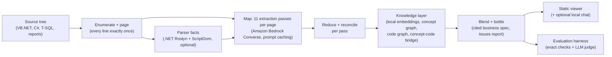

# Evaluated, cited business-spec extraction for legacy code on Amazon Bedrock

This sample shows how to build an **evaluated, cited business-specification extraction pipeline for
legacy code on Amazon Bedrock**. You point it at a source tree (the bundled example is a synthetic
VB.NET WinForms + SQL Server accounts-payable module from a fictional legacy .NET ERP). It recovers
business rules, data concepts, workflows, states, permissions, exceptions and interfaces, and writes
them up as a business-facing specification in which every requirement cites the source lines it came
from. An evaluation harness then scores the output against hidden answer keys, using exact checks
wherever it can and an LLM judge, with error bars, where meaning has to be compared.

> **Maturity: demo / sample code, not production.** It runs on one machine. Its web servers bind to
> `127.0.0.1`, and the launcher's optional shared-access-code gate is demo grade. Every run spends
> money on Amazon Bedrock. Read [Hardening](#hardening-before-you-adapt-it) before you expose
> anything beyond your own machine or point it at code you are not allowed to send to Bedrock.

## Contents

- [Architecture](#architecture)
- [Prerequisites](#prerequisites)
- [Quick start](#quick-start)
- [Run it from the web UI (launcher)](#run-it-from-the-web-ui-launcher)
- [Cost](#cost)
- [Teardown](#teardown)
- [Evaluation](#evaluation)
- [Repository layout](#repository-layout)
- [Hardening before you adapt it](#hardening-before-you-adapt-it)
- [Third-party dependencies](#third-party-dependencies)
- [Security](#security)
- [License](#license)

## Architecture



Text version of the diagram: the source tree is enumerated and split into line-numbered pages, with
a conservation check that every line is paged exactly once. An optional .NET parser adds structural
facts. Each page goes through eleven specialised extraction passes ("stills") on Amazon Bedrock.
The findings are reduced, embedded locally, linked into concept and code graphs, then blended and
"bottled" into a business-facing specification and an issues report, both with verified citations.
A static HTML viewer presents the result, and the evaluation harness scores it.

| Stage | Main code | Calls Bedrock? |
|---|---|---|
| Orchestration, phases, budget gate, resume | `run_distillation.sh` | no |
| Paging and conservation check | `runtimes/pipeline/concat-batch.sh`, `check-page-conservation.py` | no |
| Parser facts (VB.NET, C#, T-SQL) | `runtimes/facts/` (.NET 8) | no |
| Extraction prompts | `still_specs/*/prompt.md`, `spec.md` | (prompt text) |
| Map / reduce, retries, congestion control | `runtimes/mcp-server/jobs.py`, `pagecentric_invoke.py`, `bedrock_client.py` | yes |
| Knowledge layer (embeddings, graphs) | `runtimes/mcp-server/knowledge.py`, `code_graph.py`, `export_graph.py` | partly (code graph) |
| Blend, bottling, issues report | `master_blend.py`, `bottling.py`, `issues.py` | yes |
| Viewer and local servers | `runtimes/pipeline/generate-viewer-v3.py`, `serve_viewer.py`, `launcher_server.py` | chat / validate only |
| Evaluation | `eval/` | judge only |

All model calls use the public Amazon Bedrock **Converse / ConverseStream** API through
`runtimes/mcp-server/bedrock_client.py`. The default model is the Claude Sonnet 4.6 cross-region
inference profile `us.anthropic.claude-sonnet-4-6`, set with `BEDROCK_MODEL_ID`. The code-graph stage
uses Claude Haiku 4.5 (`DISTILL_CODE_GRAPH_MODEL`). Embeddings run locally with
`sentence-transformers/all-mpnet-base-v2` and are never sent anywhere.

More detail: [docs/RUN_GUIDE.md](docs/RUN_GUIDE.md) (inputs, steps, outputs),
[docs/RUNBOOK.md](docs/RUNBOOK.md) (every knob, checkpoints, exit codes),
[docs/LAUNCHER_API.md](docs/LAUNCHER_API.md) (local launcher API),
[docs/EVAL_ARCHITECTURE.md](docs/EVAL_ARCHITECTURE.md) (how the output is evaluated),
[docs/PRODUCTION_ARCHITECTURE.md](docs/PRODUCTION_ARCHITECTURE.md) (an illustrative production shape), and
[docs/THREAT_MODEL.md](docs/THREAT_MODEL.md) (threats and mitigations).

## Prerequisites

- An **AWS account** you can use for experiments (not production), with
  [model access](https://docs.aws.amazon.com/bedrock/latest/userguide/model-access.html) to
  Anthropic Claude Sonnet 4.6 and Claude Haiku 4.5 in `us-east-1` (or change `AWS_DEFAULT_REGION`
  and the model IDs).
- **AWS credentials** from any standard source: `aws configure`, IAM Identity Center
  (`aws configure sso`, then `aws sso login`), or `AWS_ACCESS_KEY_ID` / `AWS_SECRET_ACCESS_KEY` /
  `AWS_SESSION_TOKEN` environment variables. See
  [Configuring the AWS CLI](https://docs.aws.amazon.com/cli/latest/userguide/cli-chap-configure.html).
  The identity needs `bedrock:InvokeModel` and `bedrock:InvokeModelWithResponseStream` on the
  models and inference profiles you use; `./check-dependencies.sh` also calls
  `bedrock:ListFoundationModels` and `sts:GetCallerIdentity`.
- **Python 3.10 or newer** and the [AWS CLI v2](https://docs.aws.amazon.com/cli/latest/userguide/getting-started-install.html).
- **.NET 8 SDK** (optional) for the parser-facts stage:
  [download](https://dotnet.microsoft.com/download/dotnet/8.0). Without it, runs continue without
  structural facts.
- **Docker** (optional) to build the parser in a container instead of installing the .NET SDK.
- Linux or macOS, about 5 GB of free disk for the Python environment and the embedding model.

## Quick start

```bash
# 1. One-time setup: venv, Python packages, embedding model, optional .NET parser build.
./setup.sh

# 2. Verify everything, including one small Bedrock call (a fraction of a cent).
export AWS_PROFILE=<your-profile> AWS_DEFAULT_REGION=us-east-1
./check-dependencies.sh

# 3. Run on the bundled synthetic sample (copied so its README is not part of the input).
#    About 70 minutes and about USD 17 of Bedrock usage; the budget cap stops it at USD 20.
cp -r samples/ap-invoices /tmp/ap-src && rm /tmp/ap-src/README.md
DISTILL_TARGET=/tmp/ap-src DISTILL_OUTPUT=output/ap-invoices DISTILL_TARGET_NAME=ap-invoices \
  DISTILL_MAX_USD=20 PYTHONUNBUFFERED=1 ./run_distillation.sh

# 4. Check the run and its spend.
cat output/ap-invoices/run_status.json            # "complete", no failed stages
runtimes/mcp-server/.venv/bin/python runtimes/mcp-server/telemetry.py cost output/ap-invoices

# 5. Open the viewer (local only). Chat and Validate call Bedrock; browsing does not.
runtimes/mcp-server/.venv/bin/python runtimes/mcp-server/serve_viewer.py \
  output/ap-invoices/viewer output/ap-invoices/stills/shared_vectors.db \
  --source-root /tmp/ap-src --port 8080
# then browse to http://localhost:8080

# 6. Evaluate the spec against the hidden answer key.
#    --no-llm is free; drop it to run the LLM judge (a few USD).
runtimes/mcp-server/.venv/bin/python eval/score.py \
  --spec output/ap-invoices/bottled_spec/bottled_spec.md \
  --key synthetic-corpus/ap-invoices/ANSWER_KEY.yaml \
  --source-root synthetic-corpus/ap-invoices \
  --exclude ANSWER_KEY.yaml --exclude README.md \
  --max-source-chars 200000 --out-dir output/ap-invoices/validation --no-llm
```

Main outputs, under `DISTILL_OUTPUT`: `bottled_spec/bottled_spec.md` (the cited business spec),
`issues/issues.md` (ranked issues and insights), `knowledge_graph/` (concept graph, code graph and
the bridge between them) and `viewer/` (static HTML). Re-running into the same output directory
resumes, and costs nothing for stages whose inputs have not changed.

To run the unit tests (no AWS calls, no cost):

```bash
runtimes/mcp-server/.venv/bin/pip install -r requirements-dev.txt
runtimes/mcp-server/.venv/bin/python -m pytest -q runtimes/pipeline/tests runtimes/facts/tests \
  runtimes/mcp-server/tests eval/tests eval/graph/tests eval/ci/tests eval/mutate/tests \
  eval/keygen/tests eval/benefits/tests
```

## Run it from the web UI (launcher)

Instead of the command line, you can start, monitor, view and evaluate runs from a local web UI.
It uses the same pipeline and the AWS credentials of the shell you start it from.

```bash
# After the one-time setup above (setup.sh), with AWS credentials for Bedrock in this shell:
export AWS_DEFAULT_REGION=us-east-1        # a region where your Bedrock model access is enabled
runtimes/mcp-server/.venv/bin/python runtimes/mcp-server/launcher_server.py --port 8090
# then open http://127.0.0.1:8090/ in your browser
```

In the browser:

1. **Choose the code.** Either enter a **Repository URL**, plus an optional branch, tag or commit and an
   optional subfolder (for example `samples/ap-invoices` in this repository), or give an **absolute
   path** to a folder on this machine. Public git URLs work as they are. For private repositories,
   use your normal git credentials (SSH agent or a credential helper). Never put a token in the URL;
   URLs that contain credentials are refused.
2. **Estimate cost.** This clones and pages the code and shows the expected Bedrock cost by stage. It
   makes no model calls and costs nothing.
3. **Start run.** The runs table shows progress, the current stage and the money spent so far, and
   it refreshes automatically. One run executes at a time and others queue.
4. **Open the results.** When a run finishes, use **Open viewer** for the cited spec, issues and
   insights, and the knowledge graph.
5. **Evaluate (optional).** Use **Score this spec** to build an answer key from your code and tests
   (free), or upload your own rules or test cases. Then review, approve and score. The estimated
   judge cost is shown before anything is spent.

Notes:

- **Local only.** The launcher binds to `127.0.0.1` and refuses other addresses unless you pass
  `--allow-non-loopback`. Do not expose it to a network. The optional `DISTILL_ACCESS_CODE` is a
  shared demo code, not authentication, and does not make an exposed launcher safe. See
  [Hardening](#hardening-before-you-adapt-it).
- **Where output goes.** Each run is written to `output/runs/<run-id>/`. Stop the launcher with Ctrl+C.
  Runs in progress stop with it, and you can resume them from the CLI.
- **API.** The UI is built on a small JSON API; see [docs/LAUNCHER_API.md](docs/LAUNCHER_API.md).

## Cost

The sample creates no AWS resources. The only charges are Amazon Bedrock model usage, billed per
token at [Amazon Bedrock pricing](https://aws.amazon.com/bedrock/pricing/). The figures below are
**estimates** from the reference runs with Claude Sonnet 4.6 on-demand pricing. Your cost depends on
model, region, pricing changes and the code you analyse.

| Activity | Estimated Bedrock cost |
|---|---|
| `./check-dependencies.sh` (one tiny call) | well under USD 0.01 |
| Full run on `samples/ap-invoices` (2,320 lines, 3 pages) | about USD 17, about 70 minutes |
| Full run on the 2,551-line `jc-changeorders` corpus (4 pages) | about USD 23 |
| Rule of thumb | about USD 5.70 per 22K-token page with all 11 passes |
| One viewer chat question | about USD 0.60 (it sends the whole spec) |
| LLM-judge scoring of one spec | a few USD; `--no-llm` is free |

Before any model call the pipeline prints a per-stage estimate. With `DISTILL_MAX_USD` set it refuses
to start when the estimate is over the cap, and stops cleanly when actual spend reaches the cap,
printing a resume command (see [docs/RUN_GUIDE.md](docs/RUN_GUIDE.md#budget-cap)). Always set
`DISTILL_MAX_USD`, and consider an [AWS Budgets](https://docs.aws.amazon.com/cost-management/latest/userguide/budgets-managing-costs.html)
alert on the account.

## Teardown

Nothing is deployed to AWS, so there is no stack to delete. To stop all spend, stop any running
`run_distillation.sh`, `launcher_server.py` or `serve_viewer.py` process (Ctrl+C). To remove
everything the sample wrote locally:

```bash
rm -rf output/ runtimes/mcp-server/.venv runtimes/facts/structure/{bin,obj,out} eval/runs eval/ci/runs eval/logs/local
rm -rf ~/.cache/huggingface/hub/models--sentence-transformers--all-mpnet-base-v2   # embedding model
docker image rm specdistill-lean-structure 2>/dev/null || true                       # if you built it
```

Model access in Amazon Bedrock costs nothing while unused. If you created an IAM user or access key
only for this sample, delete or deactivate it.

## Evaluation

The `eval/` harness answers "how good is the extracted spec?" against code whose answers are known:

- **Synthetic corpora with hidden answer keys**: `synthetic-corpus/ap-invoices` (48 items, 7
  planted problems) and `synthetic-corpus/jc-changeorders` (51 items, 19 planted problems, plus
  Q&A, change-impact and new-app requirement sets). The pipeline never sees the keys.
- **Exact checks (no AI)**: every source line paged once, every citation points at a real line,
  graph edges confirmed by real parsers, structural checks, mutation-detection rate.
- **Estimated checks (LLM judge on Bedrock)**: recall and precision against the key, planted
  problems found, Q&A and change-impact accuracy, reported with bootstrap confidence intervals,
  judge-vs-human agreement and run-to-run agreement.
- **Suite runner** with cost plan, budget cap, provenance and regression gate:
  `python3 eval/ci/run_suite.py --config eval/ci/suites/ap-invoices.yaml --smoke` (free).

See [eval/README.md](eval/README.md) and [docs/EVAL_ARCHITECTURE.md](docs/EVAL_ARCHITECTURE.md).
Results quoted in the docs come from a few reference runs on small synthetic corpora. They do not
transfer to real systems, and a new run will differ.

## Repository layout

| Path | What |
|---|---|
| `run_distillation.sh`, `setup.sh`, `check-dependencies.sh` | Pipeline entry point, local setup, preflight check |
| `runtimes/mcp-server/` | Pipeline stages, Bedrock client, local launcher/viewer servers, MCP servers, tests |
| `runtimes/pipeline/` | Paging, conservation check, viewer generator |
| `runtimes/facts/` | .NET 8 structural-facts parser (Roslyn, ScriptDom) and its Python post-processing |
| `still_specs/` | Extraction specifications and prompts, one folder per pass |
| `samples/ap-invoices/` | Synthetic input for the quick start (no answer key) |
| `synthetic-corpus/` | Synthetic corpora with their answer keys |
| `eval/` | Scorer, judge, graph validator, mutation harness, key builder, suite runner |
| `demo/` | Example MCP client and MCP client registration |
| `docs/` | Run guide, runbook, launcher API, evaluation and production-shape notes |

## Hardening before you adapt it

This is sample code. Before you use it beyond a single trusted machine, at least:

- **Keep the servers local.** `launcher_server.py`, `serve_viewer.py` and `progress_server.py` bind to
  loopback, and the launcher refuses a non-loopback `--host` unless you pass `--allow-non-loopback`.
  Do not put them on a public network. They start paid Bedrock runs and read local files.
- **Confine MCP tool paths.** The `bedrock-distill` MCP server only accepts file and directory
  arguments inside this repository, `DISTILL_TARGET`, `DISTILL_OUTPUT` and any directories in
  `DISTILL_MCP_ALLOWED_ROOTS` (separated by `:`). Keep that list as narrow as your runs allow.
- **Replace the shared access code.** `DISTILL_ACCESS_CODE` is one shared secret with in-memory
  sessions: no per-user identity, authorization, audit trail, rate limiting or lockout. A real
  deployment needs per-user authentication (for example Amazon Cognito or IAM Identity Center behind
  an Application Load Balancer or Amazon CloudFront with AWS WAF), TLS everywhere, and authorization
  on who may start runs and read which specs.
- **Treat analysed code and model output as untrusted.** Source code can carry prompt-injection
  text, and model output is rendered in the viewer. Keep the viewer's HTML escaping and the pinned,
  integrity-checked CDN script; add a Content Security Policy; review `viewer_api.py` and
  `source_fetch.py` before accepting input from other people.
- **Least privilege.** Give the runtime identity only `bedrock:InvokeModel` and
  `bedrock:InvokeModelWithResponseStream` on the specific models and inference profiles it uses.
  Use temporary credentials, never long-lived keys on shared hosts.
- **Data handling.** Only analyse code you are permitted to send to Amazon Bedrock in your account
  and region. Outputs (`output/`) contain source excerpts. Store them encrypted, restrict access,
  and delete them when no longer needed.
- **Cost controls.** Always set `DISTILL_MAX_USD`, keep `--max-usd-ceiling` low on the launcher, and
  add AWS Budgets alerts.
- **Supply chain.** Pin and hash Python dependencies (`pip install --require-hashes`), run
  `pip-audit`, and vendor or pin browser assets. The CDN script for the viewer is pinned with
  Subresource Integrity.
- **Scale-out.** [docs/PRODUCTION_ARCHITECTURE.md](docs/PRODUCTION_ARCHITECTURE.md) sketches an
  illustrative multi-user shape. It is guidance only and needs its own threat model and review.

## Third-party dependencies

Downloaded at setup or run time, not bundled. Each is governed by its own licence:

- Python packages (`runtimes/mcp-server/requirements.txt`, `runtimes/pipeline/requirements.txt`,
  `requirements-dev.txt`): boto3, mcp, sentence-transformers (with PyTorch), networkx, numpy,
  hnswlib, olefile, PyYAML, markdown; for tests pytest, hypothesis, jsonschema.
- Embedding model [`sentence-transformers/all-mpnet-base-v2`](https://huggingface.co/sentence-transformers/all-mpnet-base-v2)
  (Apache-2.0), downloaded from Hugging Face by `setup.sh`.
- NuGet packages for the parser (`runtimes/facts/structure/LeanStructure.csproj`):
  Microsoft.CodeAnalysis.CSharp, Microsoft.CodeAnalysis.VisualBasic,
  Microsoft.SqlServer.TransactSql.ScriptDom.
- [marked](https://github.com/markedjs/marked) 12.0.2, loaded by the viewer from jsDelivr with
  Subresource Integrity.
- Optional: `runtimes/pipeline/ingest-helpers/rpt/RptExtract.java` compiles against a Crystal
  Reports Java runtime that you must obtain and license separately. It is not needed for the sample.

Bundled third-party files (Cytoscape.js, and eShopOnWeb-derived evaluation keys) are listed in
[THIRD-PARTY-LICENSES](THIRD-PARTY-LICENSES).

## Security

See [CONTRIBUTING](CONTRIBUTING.md#security-issue-notifications) for more information.

## License

This library is licensed under the MIT-0 License. See the [LICENSE](LICENSE) file.
