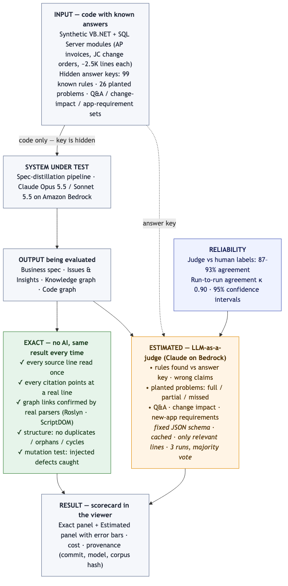

<!-- Copyright Amazon.com, Inc. or its affiliates. All Rights Reserved.
     SPDX-License-Identifier: MIT-0 -->
# How we evaluate the spec-distillation output



Source: [`eval-architecture.mmd`](eval-architecture.mmd) (Mermaid). Component view: [`eval-application-architecture.mmd`](eval-application-architecture.mmd). Code: `eval/`.

## In one sentence

We run the pipeline on code where **we already know every answer**, hide the answers from the
pipeline, and score what it produces — with **exact** checks wherever possible and an
**LLM-as-a-judge** only where meaning has to be compared, reported with error bars.

## Input — what we test on

| Test input | What it is | Known answers |
|---|---|---|
| `ap-invoices` | Synthetic VB.NET + SQL Server accounts-payable module, 16 files, 2,320 lines | 48 rules / states / workflows / exceptions; 7 planted problems |
| `jc-changeorders` | Synthetic VB.NET + SQL Server job-cost change-order module, 17 files, 2,551 lines | 51 items; 19 planted problems; 25 Q&A questions; 10 change scenarios; 14 new-app requirements |
| Any code (mutation test) | A copy of real or sample code with defects injected at known places | The injected defects |

Planted problems cover the issue types a modernization team typically asks about: duplicated logic, contradictions between screen and
database, logic flaws, undocumented behaviour, dead code, rules only in a comment, rules only in the
database. Answer keys live outside the input and are never shown to the pipeline.

## Output — what we evaluate

Business specification · Issues & Insights report · Knowledge graph · Code graph · Q&A answers ·
change-impact answers.

## How — two kinds of checks

| | **Exact** (no AI) | **Estimated** (LLM-as-a-judge) |
|---|---|---|
| What | Every line read once; citations point at real lines; graph links confirmed by real parsers (Roslyn for VB.NET/C#, ScriptDOM for SQL); no structural errors; mutation detection rate | Rules found vs the key; wrong claims; planted problems full / partial / missed; Q&A, change-impact and app-requirement accuracy |
| Model | none | Claude on Amazon Bedrock (Opus 5.5 default; Sonnet 4.6 selectable) |
| Repeatability | identical every run | varies a little — so we measure it |
| Needs an answer key | no | yes |

**How the judge is kept honest:** answers in a fixed JSON schema (rejected and retried if wrong);
verdicts cached so re-scoring is identical and free; it sees only the relevant source lines; it can
say "uncertain" instead of guessing; it runs 3 times with a majority vote.

## How reliable is it

| Check | Reliability |
|---|---|
| Exact checks | Deterministic — 0 variation across repeated runs; covered by ~1,000 automated tests |
| Judge vs a human | 87–93% agreement on 15 hand-labelled items; leans generous (e.g. scored the $10,000 screen-vs-database mismatch "full" where a human said "partial") |
| Judge run-to-run | κ 0.90 agreement; "any match" recall identical across runs; "full match" recall moves up to ±5 items |
| Small samples | 48–51 items per module → 95% confidence intervals of about ±10 points |
| Not yet measured | Pipeline run-to-run variance (each module run once or twice); real production code; very large codebases |

**How to quote results:** lead with exact metrics and "any match" recall; show judged numbers with
their confidence interval; never compare two runs on a difference smaller than the measured noise.

## Results from the reference runs (not shipped; yours will differ)

| | AP invoices | JC change orders |
|---|---|---|
| Known items found, any match | 96% (CI 90–100%) | 94–96% |
| Known items found, full match | 71–90% (depends on counting) | 75–78% |
| Planted problems | 5 of 7 full, 2 partial (human-checked) | 12 of 19 full, 6 partial, 1 missed |
| Graph links confirmed by parser | 100% | 100% |
| Citations valid | 100% | 100% |

## Running it

```bash
python3 eval/ci/run_suite.py --config eval/ci/suites/ap-invoices.yaml --smoke   # free, exact checks only
python3 eval/ci/run_suite.py --config eval/ci/suites/ap-invoices.yaml --plan    # cost plan, no spend
python3 eval/ci/run_suite.py --config eval/ci/suites/ap-invoices.yaml --budget-usd 15 --judge-runs 1
```
Or from the launcher UI: **Run evaluation** on a run → see the planned cost → confirm → results
appear in that run's viewer under **Evaluation**.

## Other evaluation options you could add

| Option | What it adds | Effort |
|---|---|---|
| SME review queue | Domain experts mark a sample of findings correct / wrong — real precision on real code | 2–3 days + SME time |
| Pipeline repeatability | Run the same input 3× and compare — measures the pipeline's own variance | ~$50, half a day |
| Second, independent judge | Score with a different model family and compare — exposes single-judge bias | 1 day |
| Larger human-labelled set (40+ items) | Tighter estimate of judge bias | half a day of labelling |
| Behavioural replay tests | Rebuild a module from the spec and replay recorded inputs/outputs — proves the spec is buildable | 2–3 days per module |
| Third domain / language | A non-construction or C# / Java sample — checks we are not tuned to one corpus | 1 day + one run |
| Larger codebase | 20–50K lines — measures cost, time and quality at scale | 1 day + one large run |
| Onboarding time test | New engineer answers 10 questions with vs without the spec — measures onboarding benefit directly | needs volunteers |
